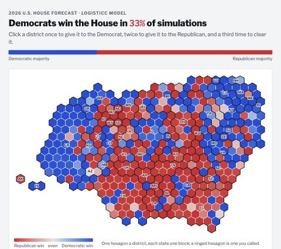
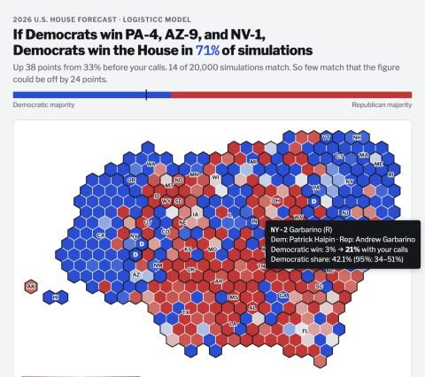
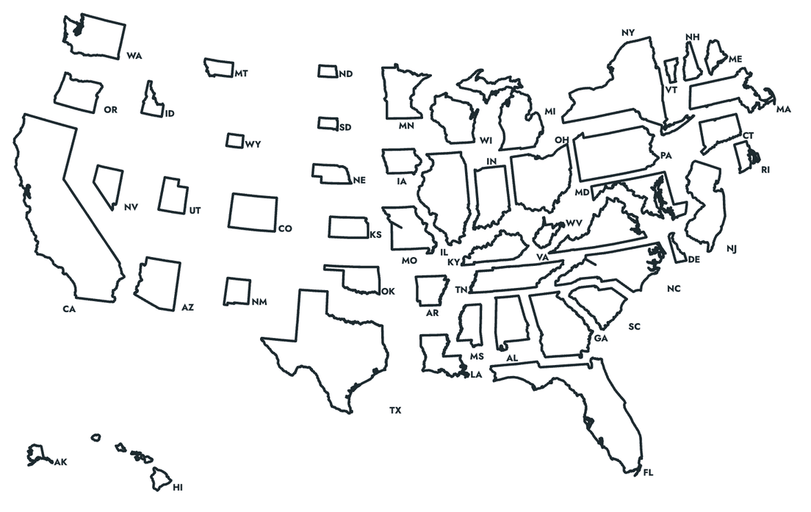
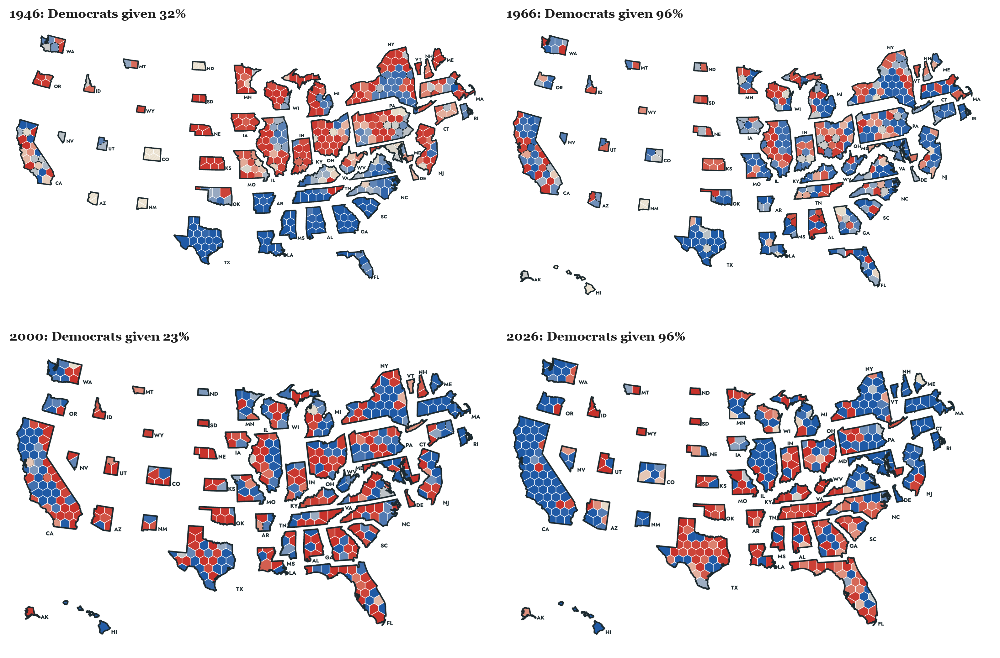
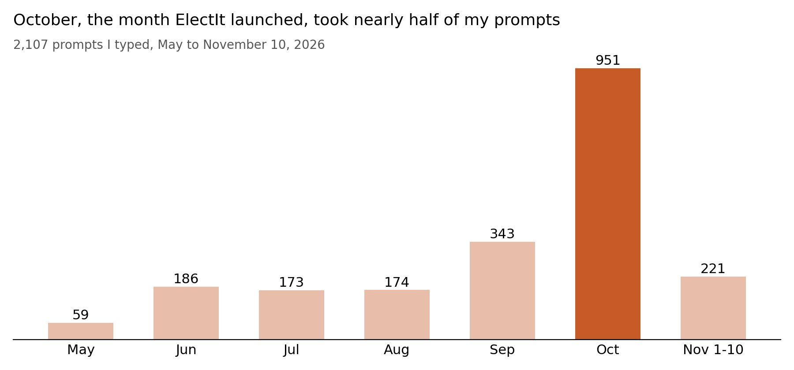
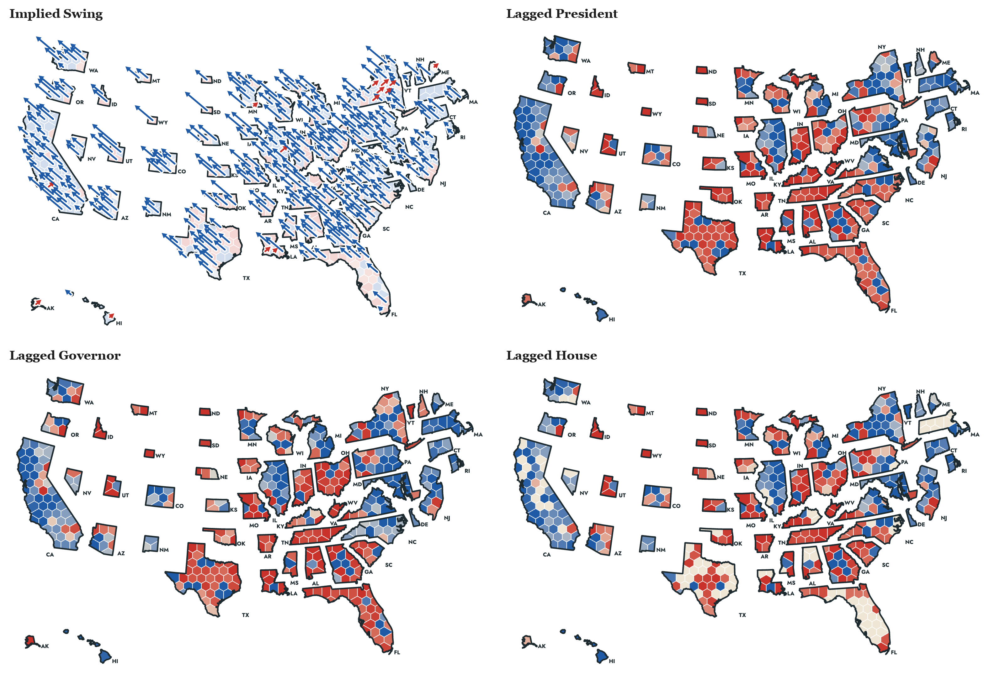
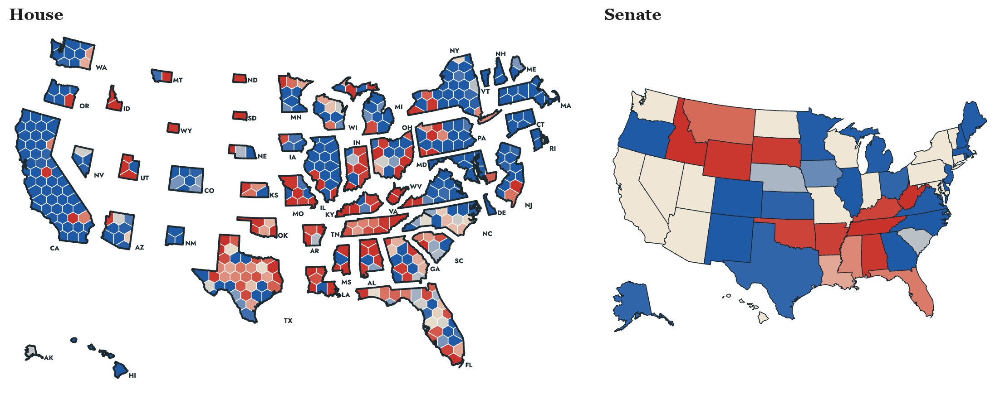

## By Danny Ebanks, PhD
## A Scholarly M-app Built in Natural Language

As political scientists, my co-authors and I know that researchers learn from being made vulnerable to being proven wrong. Somewhat unexpectedly, we proceeded to make ourselves vulnerable to being proven wrong to a global audience. Our forecast, based on our paper, "[If a Statistical Model Predicts That Common Events Should Occur Only Once in 10,000 Elections, Maybe It's the Wrong Model](https://gking.harvard.edu/10k/)," was featured on Drudge Report, Jimmy Kimmel, and organically generated 26.9 million Google impressions and more than 1.1 million views from about 690,000 unique users who spent an average of 1.1 minutes on our website, about 96,000 of them repeat visitors. In the process of producing this highly-trafficked website, we never once wrote any code by hand. Managing the absolutely astronomical amounts of output from Claude, much of which obscures the main point or lowers the quality of the product, required extensive effort. The novelty of producing content in real-time wore off quickly, as we began to think less about *what we can build and moved towards what will have impact on the widest possible audience.* Much of that effort was in rewriting output in our own words to more effectively communicate complex ideas to an audience with a broad range of technical backgrounds. 

To that end, ElectIt, our 2026 midterm forecast at [gking.harvard.edu/electit](https://gking.harvard.edu/electit/), was built almost entirely without manual coding; we prompted a frontier LLM to produce a scholarly artifact and 70 years of geospatial analysis that garnered over 1 million views. I communicated to the LLM in natural language the nature of the output I imagined in my mind, using my own words (typos and all, recorded below). Claude Code wrote all of the code that underlies the site we published, including maps, the various app tools and features, the historical displays, and the displays of the evaluation. We produced the underlying ideas, writing, aesthetics, design, and mathematical reasoning required to produce the figures reported on the map. 

We wanted to teach and reach a broad audience about probabilistic reasoning and geospatial analysis, and we believe the mass-audience interest in our work is preliminary evidence we succeeded in that goal. In this short blog post, I am excited to tell the story through the prompts I wrote in real time, distilling 10 years of research work into merely two months' effort for a previously unimaginable quality of output for your authors!

| Measure | Value | Source |
| --- | --- | --- |
| Google impressions, Oct 7 to Nov 3 | 26.9 million | Google Search Console |
| Visits from Google Search, Oct 7 to Nov 3 | 703,000 | Google Search Console |
| Site views | about 1.12 million | Google Analytics 4 (GA4), Oct 22 to Nov 10 (884,981), plus about 233,000 imputed before the tag |
| Unique users | about 690,000 | GA4, Oct 22 to Nov 10 (555,513), plus about 131,000 imputed |
| Repeat users | about 96,000 | GA4 retention |
| Peak day, Election Day (Nov 3) | 218,769 views | GA4 |
| Drudge Report referrals, Oct 22 to Nov 10 | 147,911 sessions | GA4 |
| LogisTiCC Paper views | 4,166 | GA4 |

Our work successfully garnered a broad audience and engaged folks from outside our field of political methodology. In a first for these co-authors, even late-night TV commented on our work. Jimmy Kimmel reported our forecast of the House on air. Our attempts to communicate probability to a mass audience caught Mr. Kimmel's eye, and his punchline was about how we chose to describe a 5% probability in terms of Dungeons & Dragons: "The Republicans winning is as likely as rolling a 20 on a twenty-sided die." 

[Watch the clip on YouTube](https://www.youtube.com/watch?v=KY9zDP4pH88&t=45s)

<iframe src="https://www.youtube-nocookie.com/embed/KY9zDP4pH88?start=45" title="Jimmy Kimmel Live, the ElectIt forecast segment" loading="lazy" allow="encrypted-media; picture-in-picture" allowfullscreen></iframe>

## Scholarly Artifacts and High Quality Maps currently require Thousands of Prompts, Rewriting, and Billions of Tokens

The idea of the site started essentially as an afterthought. On October 2, 2026, at 8:05 a.m. Eastern, I mentioned the idea to the LLM while I was generating figures for a talk on October 5. The idea for a map-based forecasting app to pre-register our election forecast was a second thought! So, it was mostly on a whim I asked Claude to make the first version of our app.

> https://github.com/jnkatz/forecast-2026 I want you to run this forecast code, please and produce some figures in my aesthetic style for a forecast. This should go in it's own folder. Then put those figures in the appropriate figures subdirectory in the electit-text/talk/ folder. thank you!
>
> Secondly, maybe show some produce a web widget, too, with conditional probabilities. Im picturing a cartogram with eat seat as a hexagaon, same size in the shape of the USA. then you can click on some seats so you can see "If Dems win these seats, their probability of winning is XX" at the top.

**The initial results were none too impressive, October 2 at 9:51 a.m.** The first draft, below, clearly needed more direction and aesthetic sensibility.

{: .map-figure}

**The same map a minute later,** I had added more functionality, but the aesthetics were still terrible.

{: .map-figure}

**The current state of the map. I wanted pleasing animations, and to see each district or state's story and analysis. I wanted a tactile tool that users could spend a lot of time playing on, but with features that actually were interesting and educational and not just on the page for their own sake.** 

{: .map-figure}

### How the map evolved:

| Time (ET), Oct 2 | State of the Map |
| --- | --- |
| 8:20 a.m. | A raw hexagon cartogram, colored by state, synthetic inputs for testing |
| 9:51 a.m. | The first geospatial widget: a blob map headlined "Democrats win the House in 33%", built on placeholder synthetic data while the real 53.5 GB of model output downloaded locally |
| about 10:10 a.m. | Each state redrawn inside its own outline |
| 10:25 a.m. | Real forecasting inputs: 87% |
| 12:02 p.m. | The first published version, with tabs for House and Senate forecasts |

Now, with a workable prototype of these maps in hand, I began to probe the forecast's outputs, which updated the map in real time. I transitioned from amateur geographer and took back my role as a political scientist: "And we are using the current maps, right? There was quite a bit of redistricting this year." Then: "Seats that matter most --> can we change this to the top 10 most likely pivotal seats (ie seat 218)." And by the evening: "Why is the model so much more confident?" than other forecasts for the Democrats. As it turned out, our model was correct to be confident! 

### Visual Analysis Improved the Research Output: Historical Analysis on Geospatial and Temporal Data

Most importantly, having built this prototype of a map, I could now "see" our forecast and how it worked over time, enabling me to see how the forecast "worked" in real time across 70 years of data. I did not need heuristics to analyze our forecast! This is a groundbreaking change in how I approach research for high-volume data, as I had real-time, high-quality maps in a visual language that was easily understood. I could now see in real-time the performance of the back-tests and whether they comported with my knowledge of political geography over time. I report below four House maps from the Historical Forecasts to demonstrate this visualization. We would never have previously reported these figures in a paper, but in app form, I could really see the edge cases and fix them in real time.

{: .map-figure}

I used the history to question the forecasting based on my domain knowledge. On October 18: "I also want to know why we were so bearish on dems in 2018 when no one else was. Seems bad, no? Is there some historical data we are missing." On October 20: "then, based on historical performance of our model + relative historical performance against others, how are we most likely to get it wrong?" 

### High-Quality Products are a Many-Shot Task: Thousands of Prompts

According to Claude, I submitted about 2,100 prompts across 56 Claude Code sessions for this project, and Claude wrote about 91 million tokens in reply. About 1,170 of those prompts came after October 2, the day the first map was generated by Claude.

{: .map-figure}

### Building Requires Billions of Tokens and Hundreds of Thousands of Agents

| Tokens, May to November 10, 2026 | Count |
| --- | --- |
| Output Claude wrote | 91.5 million |
| New input | 1 million |
| Input written to cache | 690 million |
| Cached input re-read | 44.4 billion |
| Total | about 45 billion |

Nearly all of the token usage is Claude having to refer to the large cache of input and output. Every prompt I submitted required sending and re-reading the whole conversation I had already generated. Given the complexity of the project with thousands of moving parts, this token expenditure was essential. In the course of this project, Claude deployed *107,000 agents*, about 68,000 of which were subagents working in parallel, and 85% of the output came from Opus 5.5 (the highest quality LLM at this price point).  

### Rewriting to Communicate Clearly to a Broad Audience

Claude's writing is opaque, generic, and lacks individual panache and surprising choices that make writing memorable for most readers. LLMs also tend to produce a large quantity of text, replete with clichés, even in places where more text obscures the main point. If good writing is "big picture first", then Claude writing operates under the mantra "no picture at all". In effect, much of my prompting was directing Claude to rewrite its opaque text with my own words to communicate complex ideas about probability and stochasticity to a broad audience in a way that both makes sense and is accurate.

| AI-Generated Text | Human-Generated Rewrite |
| --- | --- |
| A scenario tool | "Change it to: Build your own Election Day Scenarios" |
| "No calls yet" | "No districts called yet" |
| "Our forecast gives this combination of calls no chance." | "Our forecast gives your scenario 0.0 probability" |
| "your calls" | "your scenario" |
| A long seat-change sentence | "Seat Changes: D+ 19 \[-4,+57\] consistent with how we show national vote" |
| "13% of simulations" | Gary: "you should drop 'of simulations'. simulation is just a method of calculation." |

To that end, I edited the math explanations line by line. Below are two examples of a generated sentence and my rewrite of that text. As you can see, the AI-generated text is often impenetrable and missing important context. I needed to add details about antecedents, remove vague writing, and overall add more flair to make the writing memorable.  

Clearly explaining the technical details of the forecast required extensive human intervention. LLMs are potentially optimized to communicate with other LLMs (via rewards for chain of reasoning and coordination among 107,000 agents and verifiable rewards), but not necessarily with other people. A common finding in math is that LLMs produce accurate, verified output that is incomprehensible to most humans at first glance. Note our edits below:

| AI-Generated Text | Human-Generated Rewrite |
| --- | --- |
| "This second weight asks, for each simulation, how plausible the most recent observed value, D+8.3, would be if that simulation's national vote were the truth, given the regression's error and the drift." | "The intuition behind this second reweighting is that given new information in the form of the Generic ballot (D+8.3), we ask how likely this observation is taking the national vote as given, alongside the regression error structure and polling drift we estimated above." |
| "More days left, a faster pace, or a larger error widen the range of outcomes and move every chance toward a toss-up, never back toward the Post-Nomination Forecast" | "Uncertainty in our model, whether due to forecasting the election result earlier in the election cycle or due to larger estimated polling error (which is driven upwards when constituent pieces of the data give conflicting signals), is hedged towards a toss-up election." |

## Individual Creativity is Facilitated by Claude

Generic UI/UX design from Claude is everywhere these days, so we needed to be more creative to make a product that had its own unique design identity and stood out among many competitors. Otherwise, we would look like another lazily-coded application. Worse still, Claude *loves* to generate useless text *everywhere*. I was constantly asking the model to remove distracting, extraneous text and bloat all over the app. So, even though by October 3 the map was functional, I wanted a more distinctive look that reflected my sensibilities about graphic design and for it to stop looking AI-generated and to communicate clearly without so much text. As the idea struck me to improve the aesthetics, my prompts that afternoon focused on aesthetics and my (literal) personal style:

> Can we make tge borderlines thicker, and and have all white? I want the design to not look like a vibe coded app, something aesthetically kind of cool that suits my pesonality?

> Can we use latex fonts, rounded corners, add a card below the map with a snake that shows XX competitive seats most likely to likely to be tipping point near 218 that autoupdates aso people can see how the map changes and who is at risk

> The snake: 58 competitive seats around 218 bad title... maybe Competitive Seats that Determine House/Senate Control (tab deendent) As a shadow behind the cards. And make the border lines (not in the map) even thicker. Also the snake needs to actually snake

> Can we try a mid-century modern style design with IQSS style oranges?

> Make the shaow orange have some alpha/transparecny. and can we add some tasteful animations for the cards?

The aesthetics of the site as it is currently displayed, including LaTeX fonts, rounded edges, an orange shadow, a snake of tipping-point seats, were a result of my individual design choices based on those five messages in about an hour and a half of iterating with the LLM.

A geographer's expertise would make these maps better still: better cartogram and hexagon-layout algorithms, projections and plotting choices that are outside my area of domain expertise, etc... The prompts reflect the expertise of the person writing them (me), so the maps are only as good as the geographic ideas with which I am familiar.

### Improving Forecast Accuracy

Other prompts were about accurately reporting probability and statistics to a mass audience:

- "We can note at-large seats and just note we dont forecast them on the maps in some nice way."
- "Can you make sure the candidate names are in all the cards (best candidate, tipping point, etc) show up in all the maps. they're missing in quite a few, like 2004"
- "On the snake, we need something like partitions for tossup, lean D, Lean R, Likely (noted on the snake): ... Anything 40-60% odd is a tossup, 20-40 is lean, 1-20, likely, <1 safe" (this came straight out of a Slack thread where Gary Jacobson asked why our expected seats and our count of favored seats differed)
- "btw, i should be able to over over lines and see the time and current estimates in a menu. or press on a touch screen phone"
- "Looks bad: and check mobile, too"

### Real time Feature Development: Quality Helps more than Quantity

Since I was freed from needing to code, I could think of the highest-value features to include and generate. I really felt quality was more important than quantity for maximizing impact. I had coffee chats with professors and my adviser from graduate school who advised me to engage in some "qualitative marketing analysis". So, I thought to myself "what would folks who know no math but are interested in politics and quantitative analysis want to see?" I asked my co-authors and my friends exactly that! They obliged me, and I decided what would be more interesting and impactful to include based on that feedback. I directed Claude to add new overlays and explanations on the map, one layer at a time:

- October 9: "show the implied swing arrow on the 2026 map (Call it Implied Swing)"
- The same night: "Maybe we can add turn the swing button into a menu button (like elsewhere) that let's you show Lagged Presidential" and "Lagged Gubernatorial" and "Lagged House" and "Lagged Senate" results. ... Thse would not be arrows, just overlays in colors."
- November 4, after Steven Clift wrote that he couldn't find House results in hexmap form: "can you add this (and the overlays we have like Swing etc..) on our map on the how we did tab"
- November 8: "on relative lean charts everywhere, put the national average in parantheses (D+XX) or (R+XX)"

{: .map-figure}

## Engaging users on the map by building their own election forecast

As I worked, I had an idea to be able to click-a-seat and do more in-depth analysis. On October 3 I laid out the vision for the app in this prompt:

> In our app, one use JK's approach, 2 let people pick their own GCB as an option. 3 show share of competitive seats (seats between 20-80% chance dem), and auto update t(36) to the current date and have a live feed of the GCB from JK's preferred source, have it live update once an hour? I want tabs: model only, model+ polling, model+polling+modelled regional error

The same day I asked for the figure that shows how geography-based seats are generated from votes:

> 1. A seats–votes curve, JudgeIt-style: Democratic seats against the national vote across the simulations, with 218, today's generic ballot and the 51.9% toss-up marked. It answers your political-geography question in one picture.

Then I rewrote its caption in my own words, because the generated one was unreadable:

> If national vote is a tie, we expect Democrats win about 203 House seats, 15 short of a majority; the House would be a toss-up, if the national vote is actually between 51.9–52.3%. Given today's estimate of the generic ballot, D+8.0, we expect a national popular vote of about 53.6%.

### Model Informed Map Analysis of Polling Error

Knowing polling error is a common concern with election forecasts, we wanted to describe and analyze the size of the polling error needed to overturn our forecasts. We generated Model-Informed Analysis of potential polling error under the map, which was derived from prompts like these. Notice how often I had to change Claude's editorial decisions which were often not to my taste and violated some principles of teaching or communicating that I thought were obvious:

- "on paths, emphasize which party wins control of that house of congress in that scenario and how often"
- "For house and senate we need only top 3 most democratic and top three most republican scenarios. Not six democratic ones"
- "For choose your own polling toggle, for unpolled districts, assume average poll noise for that year's forecast and let people toggle the polls there, too"
- "A polling error of normal size in the Republicans' favor would likely leave Democrats in control of the House, but put control of the Senate in doubt, more of a pure toss-up."

The scenario that best reflects the result (posted weeks in advance!) is reproduced below (emphasis on our forecast of the newspaper headline is mine).

> **Historic Polling Error Favoring the Democrats.** A blowout (with 0.11 probability, Democrats win the Senate and 266 or more House seats)
>
> Democrats win big: There is a historic polling error where the Democrats win the national vote by about 13 points, where we expect 8. By a historic polling error, we mean an error of two or more standard deviations, 4 pp or more, larger than any since 1950. They take the Republican seats in Colorado, Florida, Virginia and Texas that our forecast had leaning Republican. They win about 19 of the 75 seats our forecast had likely Republican, where we expect 5. Lauren Boebert (CO-4), Anna Paulina Luna (FL-13) and Virginia Foxx (NC-5) lose. Democrats finish with about 274 House seats. Democrats take the Senate with about 56 seats by holding Michigan and winning Texas, Iowa and Kansas. **A potential headline the morning after the election: Democrats win both chambers of Congress and their largest House majority since 1978.**
>
> The national vote would have to be about 4 points more Democratic on margin than we currently forecast. We expect a Democratic two-party House vote of 54.2%. When Democrats win the Senate and at least 266 House seats (probability 0.11), the national popular vote averages 56.4%, which is 4.2 points more Democratic on margin than our forecast. Since 1950, the median polling error was 2.0 points. The largest in the Democrats' favor was 2.7 points (1970), followed by 2.5 (2010), and no error in either party's favor reached 4.2. For Democrats to win this big therefore requires a polling error larger than any since 1950.

And the associated map with this model-informed scenario of being wrong: 

{: .map-figure}

## Clearly Communicating to Humans about a Statistical Forecast Requires Extensive Human Rewriting

We were concerned that normal people would need extra information about the nature of a 5% chance. We do not experience the world probabilistically, so human intuitions need more context when communicated to really "understand" probabilities. Our final forecast gave Democrats about a 96% chance of the House and 78% of the Senate. To give a mass audience a real sense of the nature of these probabilities and the interpretation of a 22% probability of the underdog winning the election required more human-generated explanation. 

### Probability is not Intuitive

We live in a deterministic world, so percentages and frequencies about counterfactual outcomes (who would have lost the election if the polls were wrong) and Monte Carlo probabilities (what does a 22% chance the Democrats lose the Senate really mean) are inherently confusing to readers even with extensive background in statistics, that is to say, most people. We added some text here to make these probabilities "feel real" to folks of all mathematical backgrounds.  

The intuitive explanations were generated from three messages I sent on October 17, between 2:53 and 2:55 p.m.:

> For each of the ten percent inferval, can you find events that will go into a dynamic ? near the probabilty of chamber control at the top. it will say "The \[underdog (replace with party not favoried to win)\] winning is as likely as \[some event that occurs at roughly that rate that people know about\]

> A coin landing heads when you call tails is one. for 1/6: rolling a 6. 1/12: rolling snake eyes with dice etc..

> maybe for 1%, 5%, 10%, 20%, 25%, 33%, 40% ,50%. dont show the probs, just fill in my statement

To make these probabilities abundantly clear to audiences, I generated about ten of these commonly understood events, like guessing the last digit of a telephone number or rolling a 20 on a D20 die in Dungeons and Dragons.  

On October 27, I asked for the comparison to be checked against history and automated for every year:

> Our forecast expects the underdog to win with these odds every YY years. The last time an underdog won with similar odds was YYYY.

## Every Historical Election Can be Evaluated on a Dynamic Map

On October 21, I asked the LLM to generate for each previous election the same analysis as 2026, but with the added twist that we know how the election unfolded.

> I want you to go back in history and generate one of these cards for what actually happened, right below the map hewing as close to my language as possible. But instead Post-Election Analysis with only one tab that says "Normal Polling Error (R)" say, for 2016 or whichever.

In order to learn how our model worked (or didn't), I then asked the analysis to be honest about how the model succeeded or failed. I was also a stickler for small details:

- "And if the fundamental model whiffed and that hurt us, just say so (since it was pre-polling error)"
- "Oh, we need to account for correlated errors, which were large in 2016/2020? Maybe we can say something about that in the text of these historical cards?"
- "A few notes, I want to have first names in the Analysis cards Adam Hamilton (D-KS) or Tom Suozzi (NY-3) where the (NY-3) takes you to the district or state card when you click on it"

## Forecast evaluation

We published the Post-Nomination Forecast on October 15 and promised not to change it. This meant the evaluation had to be built before we knew the answer, and judged, of course, on our own terms, which we laid out prior to the election.

### 2026 Forecast Evaluation

The day after the election I asked for a new tab: "Can you write a new tab 'how we did in 2026' using these preliminary returns". Gary set the bar in a Slack message I passed straight through:

> our first standard has to be versions of the graphs we have in the main paper. calibration, 1-in-10k, etc. we don't have to be better than anyone else. just fit our own standards

The prompts that shaped the evaluation:

- "and show competitive calibration and dem chance of winning"
- "for polls plus, show our usual metrics over time (calibration, coverage, 1-in-10k etc) over time"
- "Change How we Did to 2026 Forecast Evaluation"
- "the question here is how we did, and so we should probably orient all the presentations toward answering that specific question. something like up (to the right, wherever) is good (meaning we do well) or bad for us. or at least some explanation for each item"
- "yes, add the average to the evaluation tab too"

Even at the evaluation stage, we incorporated useful feedback from our readers. For example, Steven Clift wrote that he was "having a hard time finding general audience House election results in the hexmap format," so I directed the LLM to create before-and-after maps with more map overlays on the 2026 Election Forecast evaluation tab of the site.

## Lessons for creating a high-impact Scholarly Work with Claude

The statistics, ideas, novel design elements, and creativity came from our paper and our conversations as co-authors; we communicated our big picture view to Claude, which implemented our ideas. We note a few takeaways from this experience below:

1. **Use your imagination first.** Implementation is now secondary to the limits of our imagination. For example, I started this whole project with "Im picturing a cartogram with eat seat as a hexagaon". I had an ambitious idea first, and then worked on polishing it as I iterated.
2. **Rewrite everything.** Most of my edits to Claude's writing involved rewriting jargon and clarifying unclear language. Users of these types of objects are enthusiastic students, and to reach a mass audience, we need to write clear prose that teaches readers new concepts in ways they did not anticipate.
3. **Collect feedback in real time from potential users.** I pasted Slack threads from Gary, JK, Gary Jacobson and Dominic Skinnion into some prompts verbatim, and then the LLM generated content in line with their ideas.
4. **Insist on honesty about Mistakes and Potential Edge Cases.** "if the fundamental model whiffed and that hurt us, just say so" is an example of such an instruction. I insisted on epistemic honesty.
5. **Generate Analysis on Potential Failure.** "Why is the model so much more confident?" on day one, and "how are we most likely to get it wrong?" three weeks later.
6. **More content is not better.** Managing the output from Claude, much of which obscures the main point or lowers quality of the product, required a lot of effort. The novelty of producing content in real-time wore off quickly, as we began to think less about *what can we build* and moved towards *what will have impact on the widest possible audience?*

| Prompting at a glance | Value |
| --- | --- |
| First prompt | October 2, 2026, 8:05 a.m. ET |
| First published version | same day, 12:02 p.m. ET |
| Post-Nomination Forecast frozen | October 15, 2026 |
| Election | November 3, 2026 |

## Map Timeline, Day by Day

Here is a timeline below generated from a prompt on the date shown (Eastern time), dated from my messages and the commit log.

| Date | Map feature added |
| --- | --- |
| Oct 2 | Hexagon cartogram, one equal hexagon per district; click seats to see the conditional odds; each state in its own outline; House and Senate tabs; the 2026 district lines; top 10 pivotal seats |
| Oct 3 | Thicker borders on white; LaTeX fonts and rounded cards; the snake of tipping-point seats below the map; mid-century modern IQSS oranges with a transparent shadow; card animations; forecast tabs; seats–votes curve |
| Oct 3 (night) | Candidate names on every card in every year's map; at-large seats noted on the map |
| Oct 6 | A third tab with district and state polls, and its historical view |
| Oct 8 | Implied Swing arrow on the 2026 map; the swing button becomes a menu of overlays: Lagged Presidential, Gubernatorial, House and Senate |
| Oct 15 | Historical maps and calibration limited to 1946–2024, the years in our paper |
| Oct 16 | The map and the snake fill in with the odds on first load, sweeping west to east as on election night |
| Oct 17 | Snake partitions for toss-up, lean, likely and safe; hover or tap any line for its time and estimates; mobile checks; a distribution of outcomes for each seat |
| Oct 21 | Post-Election Analysis card below the map for every past year; scenario maps for the Model-Informed Analysis card |
| Oct 22 | Candidates' first names in the analysis cards, with each district label (NY-3) opening its district card |
| Oct 24 | Odds over time on every historical tab, 1946–2024; preloaded so the maps open at once |
| Nov 1 | Favored Candidate over Time on each race card; historical tabs preloaded |
| Nov 4 | How We Did tab with the results map and our overlays, after Steven Clift asked for hexmap results |
| Nov 5 | Map options tab for the 2026 state-level House popular vote and its swing from 2024 |
| Nov 6 | Hover highlights a whole state, with a shorter hover menu showing the Democratic margin |
| Nov 8 | National average shown in parentheses (D+XX or R+XX) on every relative lean map |
